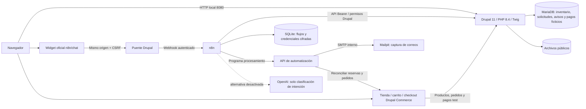

# Arquitectura del prototipo

Solo `drupal/web` es público. Composer y `vendor` quedan fuera del DocumentRoot. Las credenciales provienen de `.env`, excluido de Git y del contexto Docker. El usuario de servicio de n8n carece de permisos del panel hotelero. Los visitantes consultan una solicitud solo con código y clave privada; nunca obtienen listados de clientes.

MariaDB es la fuente de verdad del negocio simulado. Un bloqueo InnoDB serializa las escrituras de habitaciones, reservas y pagos ficticios. El intervalo de ocupación es `[ingreso, salida)`. No hay cobros reales ni confirmaciones del establecimiento real.

Drupal Commerce conserva productos, variaciones, pedidos y pagos en la misma MariaDB. Cada línea representa una habitación con fechas y huéspedes; `roma_shop_booking` la relaciona con una solicitud hotelera. El precio y las noches se recalculan en el servidor. El checkout registra todas las solicitudes y el pago local dentro de una transacción. La pertenencia del carrito y del recibo se controla por sesión o usuario. El pago test no confirma habitaciones; el estado del pedido se reconcilia mediante n8n a partir de las decisiones administrativas.

Las interfaces se enlazan solo a localhost. Los contenedores se comunican por su red interna. El widget utiliza el mismo origen de Drupal, sin CORS global. Las notificaciones se capturan en un servidor SMTP de prueba; no salen al correo de personas reales. El transporte SMTP está fijado a Mailpit en la implementación de demostración.

La alternativa de IA no determina precios, fechas, disponibilidad ni estados: solo clasifica una intención, y Drupal produce la respuesta desde la base. Por defecto no se invoca ningún proveedor de IA.

## Recepción y disponibilidad operativa

El módulo `roma_reception` mantiene entradas/salidas, limpieza, mantenimientos y auditoría en MariaDB. Comparte la fila InnoDB `roma_guard` con las reservas y extiende sus comprobaciones mediante hooks: las mismas restricciones se aplican a web, API, Commerce y chatbot n8n. Una salida conserva la reserva comercial y libera inventario; no altera pagos ni emite comprobantes. Las rutas administrativas usan el permiso `manage roma reception` y formularios Drupal con CSRF. Véase [la verificación de recepción](verificacion.md#verificacion-recepcion).
