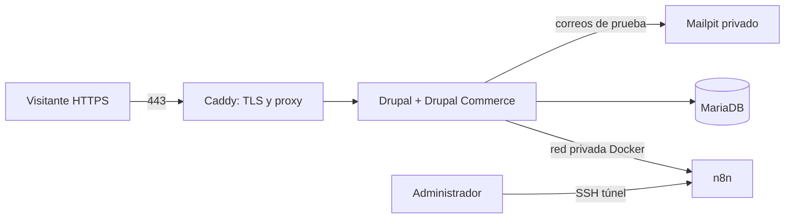

# Desplegar el prototipo en AWS EC2

Esta guía explica cómo instalar el proyecto en EC2 con Docker Compose. Ya existe un despliegue de demostración en AWS Academy, documentado en [la verificación de EC2](verificacion.md#verificacion-aws). Para repetirlo se necesita acceso autorizado a una cuenta AWS y un nombre DNS; puede usarse un dominio propio o uno temporal para una demo. AWS puede generar cargos.

## Arquitectura propuesta



En la instancia viven Drupal, MariaDB, n8n, Mailpit y Caddy. Caddy publica Drupal y obtiene certificados HTTPS al apuntar el dominio a la IP de la instancia. MariaDB y Mailpit no publican puertos. n8n conserva su puerto enlazado a `127.0.0.1` en el servidor y se administra mediante un túnel SSH; el visitante usa el chat integrado en Drupal. Así no se expone el editor n8n al público. Los datos persisten en volúmenes Docker.

Es una instalación académica de una sola instancia, adecuada para demostración. No tiene alta disponibilidad ni recuperación administrada. Para operación real habría que planificar copias fuera de la instancia, actualizaciones, monitoreo y recuperación; el prototipo no está autorizado por el hospedaje ni tiene una pasarela de pago real.

## Requisitos previos

- Cuenta AWS con permisos para EC2, VPC, IP elástica y grupos de seguridad.
- Dominio propio bajo control del equipo. Se usará `reservas.tudominio.pe` como ejemplo; sustitúyelo por el dominio real.
- Repositorio GitHub privado accesible desde EC2. Usa una Deploy Key **de solo lectura** y guarda su clave privada solo en el servidor; no la añadas al repositorio.
- Una instancia Ubuntu Server LTS. Dimensiona RAM y disco según las pruebas; Drupal, MariaDB y n8n comparten memoria. Para una demo pequeña, empieza con al menos 4 GiB de RAM y disco SSD de 30 GiB, y vigila métricas antes de aumentar el uso.
- Docker Engine y el complemento Docker Compose instalados desde el repositorio oficial. Verifica `docker --version` y `docker compose version`.

Revisa el costo de instancia, disco, transferencia e IP pública en la calculadora oficial de AWS antes de iniciarla. No se fija un precio aquí porque depende de región, tipo de instancia, uso y fecha.

## 1. Crear la instancia y restringir red

En EC2, crea una instancia Ubuntu LTS, asocia un volumen EBS persistente y asigna una Elastic IP para que el DNS no cambie al reiniciar. En el grupo de seguridad permite solo:

| Puerto | Origen | Uso |
| --- | --- | --- |
| TCP 22 | Tu IP pública `/32` | Administración SSH |
| TCP 80 | `0.0.0.0/0` y `::/0` | Validación y redirección HTTPS de Caddy |
| TCP 443 | `0.0.0.0/0` y `::/0` | Drupal público con TLS |

No abras 3306, 5678, 8025 ni 8080 en el grupo de seguridad. Las reglas de seguridad de AWS actúan como firewall de entrada y conviene limitar SSH a la dirección del administrador.

En el proveedor DNS crea un registro A para `reservas.tudominio.pe` que apunte a la Elastic IP. Espera la propagación DNS antes de iniciar Caddy.

## 2. Clonar el repositorio privado

Conecta por SSH usando la llave EC2 y registra una Deploy Key de solo lectura en GitHub. Sigue el procedimiento oficial de GitHub para usar deploy keys; instala el archivo de clave en el servidor con permisos `600`, añade `github.com` a `known_hosts` tras verificar su huella y clona por SSH. No copies una llave personal con permisos de escritura ni pongas un token dentro de la URL Git.

```bash
git clone git@github.com:devmijaelflores-boop/hostal-roma-drupal-n8n.git
cd hostal-roma-drupal-n8n
```

## 3. Crear y ajustar secretos del servidor

```bash
python3 scripts/init-env.py
chmod 600 .env
nano .env
```

El generador crea secretos de demostración y no sobrescribe uno ya existente. Cambia las contraseñas de MariaDB y del administrador, el salt, las claves de integración y la clave de cifrado n8n por valores únicos antes de exponer el servidor. Conserva `.env` con modo `600`; nunca lo subas a GitHub ni lo copies a una captura.

Ajusta o agrega estas variables en `.env`:

```dotenv
DOMAIN=reservas.tudominio.pe
ROMA_PUBLIC_URL=https://reservas.tudominio.pe
ROMA_TRUSTED_HOSTS=reservas.tudominio.pe
ROMA_REVERSE_PROXY_ADDRESSES=172.30.99.2
DRUPAL_PORT=8080
N8N_PORT=5678
MAILPIT_PORT=8025
```

Los tres puertos de aplicación continúan enlazados solo a `127.0.0.1`; no cambies sus enlaces a `0.0.0.0`. `ROMA_TRUSTED_HOSTS` acepta nombres separados por coma, no URLs. El host interno `drupal` se añade automáticamente para llamadas dentro de Docker.

Caddy tiene la dirección fija `172.30.99.2` en una red Docker exclusiva para el proxy. Drupal confía en sus cabeceras de protocolo e IP únicamente cuando se configura esa dirección; así reconoce HTTPS para enlaces y cookies. Si esa subred ya está ocupada en el servidor, cambia el bloque `networks.proxy` y la dirección de confianza conjuntamente antes de desplegar.

## 4. Instalar y arrancar

```bash
sh scripts/start.sh
docker compose --profile aws up -d --wait caddy
docker compose ps
```

El primer comando construye la imagen, instala Drupal, publica los workflows ROMA y ejecuta las comprobaciones del proyecto. El segundo habilita Caddy, que escucha en 80/443 y solicita automáticamente TLS. Consulta los errores con `docker compose logs --tail=100 caddy drupal n8n` y `docker compose ps`.

Comprueba después desde un navegador:

- `https://reservas.tudominio.pe/`
- `https://reservas.tudominio.pe/tienda`
- `https://reservas.tudominio.pe/disponibilidad`

Prueba el chatbot y una reserva con datos ficticios. Una reserva o pago de prueba no representa disponibilidad real ni cobra dinero. La bandeja de correo Mailpit es solo de demostración y no envía notificaciones a clientes reales.

## 5. Administrar n8n sin publicarlo

Desde la computadora del administrador abre un túnel SSH; sustituye la llave, IP y usuario por los de la instancia:

```bash
sh scripts/aws-tunnel.sh IP_ELASTICA ~/.ssh/roma-ec2.pem
```

Mientras el túnel siga abierto, entra en `http://localhost:15678` desde esa computadora e inicia sesión en n8n. La bandeja de correos de prueba queda en `http://localhost:18025`. No añadas reglas públicas para los puertos 5678 ni 8025. Las credenciales n8n importadas por el script permiten a los workflows consultar Drupal desde la red privada de Compose.

## 6. Actualizar y respaldar

Antes de actualizar, respalda MariaDB y los volúmenes Drupal/n8n. Una copia guardada solo en el mismo volumen EBS no protege frente a pérdida de la instancia; copia los respaldos cifrados a un destino separado con permisos restringidos y ensaya su restauración. Nunca incluyas `.env` en los respaldos compartidos con el equipo.

Para una actualización controlada, consulta cambios, haz backup, despliega el commit revisado y comprueba logs, tienda, reservas y chatbot. No ejecutes `docker compose down -v`: elimina los volúmenes con datos.

## Lista de verificación antes de presentar

- [ ] El dominio resuelve a la Elastic IP y abre con HTTPS válido.
- [ ] Los puertos 8080, 5678, 8025 y 3306 no son accesibles desde Internet.
- [ ] `.env` existe solo en el servidor con permisos restringidos y valores no predeterminados.
- [ ] Drupal, tienda y chat responden; el workflow consulta datos de Drupal.
- [ ] Se comunica claramente que habitaciones, tarifas, disponibilidad y pagos son demostrativos.
- [ ] Hay respaldo externo y se conoce cómo restaurarlo, si el equipo decide usar el prototipo más allá de una exposición.

## Fuentes oficiales

- [Crear un grupo de seguridad de EC2](https://docs.aws.amazon.com/AWSEC2/latest/UserGuide/creating-security-group.html).
- [Reglas de grupos de seguridad para web servers](https://docs.aws.amazon.com/AWSEC2/latest/UserGuide/security-group-rules-reference.html).
- [Calculadora de precios de AWS](https://calculator.aws/).
- [Instalar Docker Engine en Ubuntu](https://docs.docker.com/engine/install/ubuntu/).
- [Docker Compose y secretos](https://docs.docker.com/compose/how-tos/use-secrets/).
- [GitHub: administrar Deploy Keys](https://docs.github.com/en/authentication/connecting-to-github-with-ssh/managing-deploy-keys).
- [Caddy: HTTPS automático](https://caddyserver.com/docs/automatic-https).
